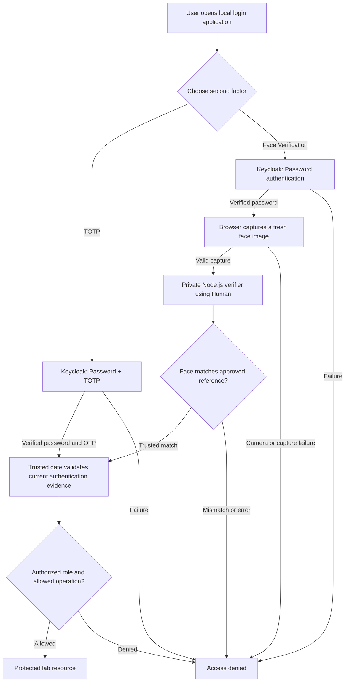

# User Accounts and Multi-Factor Login Security

**Information Systems Security · Group 1 · Phase 2 · Kali Linux Lab**

**Project version:** Draft v0.5 — Face Verification + TOTP  
**Phase 2 deadline:** 30 November 2026  
**Status:** Implementation in progress; integrated authentication and security tests pending.

## Project Overview

This project aims to protect user accounts and sensitive operations using flexible Two-Factor Authentication (2FA) and Role-Based Access Control (RBAC).

Every ordinary login requires a valid username and password, followed by **one second-factor method selected by the user**:

1. **Password + TOTP:** A time-based one-time password generated by an enrolled authenticator application.
2. **Password + Face Verification:** Experimental facial verification using the Human JavaScript library and a webcam.

Both authentication methods are supported, but the user completes only one selected second factor per login. This is flexible 2FA, not mandatory three-factor authentication.

Keycloak manages user accounts, passwords, TOTP and roles. Human provides the facial recognition capability. A trusted local backend enforces authentication, second-factor completion, session validity and role-based permissions before allowing access to protected operations.

The system protects an ordinary user resource and an Administrator-only operation in an isolated Kali Linux laboratory environment.

## Authentication Methods

| Authentication Route | Required Factors | Verification Responsibility |
|---|---|---|
| Password + TOTP | Correct password and valid TOTP code | Keycloak verifies authentication factors; the trusted gate validates the completed authentication evidence. |
| Password + Face Verification | Correct password and a matching enrolled face | Keycloak verifies the password; the local Human-based verifier compares the face; the gate enforces the trusted result. |

**Important authentication rules:**

- A valid password alone never grants protected access.
- Each authentication attempt uses one selected second-factor method.
- Switching methods cancels the current attempt and requires fresh authentication.
- TOTP does not require camera interaction.
- Face Verification does not require a TOTP code during its ordinary login path.
- Authentication evidence cannot be substituted between the two paths.
- A successful browser message cannot independently authorize access.
- The gate must validate the user's role before performing a protected operation.
- Failed or incomplete authentication results in access denial.

## Technology Stack

| Technology | Purpose |
|---|---|
| Kali Linux | Main operating environment for all computer-side project components |
| Oracle VirtualBox | Virtual machine environment running Kali Linux |
| Keycloak | User accounts, passwords, TOTP, authentication configuration and roles |
| Human | JavaScript-based face detection, descriptor extraction and facial comparison |
| JavaScript / Node.js | Local application, facial verification integration and trusted backend components |
| HTML / CSS | Browser-based login, camera capture and enrollment interfaces |
| Webcam | Capturing facial samples for enrollment and verification |
| Google Authenticator or compatible application | Generating TOTP codes on a separate device |
| Curl | Authorized API and authentication testing |
| Nmap | Authorized inspection of exposed laboratory services |

**Technology restrictions:**

- All computer-side components must operate within Kali Linux.
- No Python is required or permitted in the implementation.
- Facial verification must use the Human JavaScript library.
- No cloud-based biometric verification service is required.
- No unnecessary paid services are required.
- Biometric templates and authentication secrets must remain outside the public repository.

The selected Human and Node.js versions, model assets and backend compatibility must be tested and documented before claiming a completed server-side verifier.

## System Architecture

The project uses a logically centralized, trusted access-control gate.

The browser allows the user to select an authentication method and capture a facial sample when required.

Keycloak provides authenticated identity and account-role information.

For facial verification, a private local Node.js component uses Human to compare a newly captured face against the reference associated with the authenticated user.

The trusted gate verifies the appropriate authentication evidence, selected method, current session, user role and requested action before granting access to a protected resource.

The diagram describes the intended architecture, not a completed implementation.

### Security Boundary

The trusted gate is responsible for protected access decisions.

Browser-controlled values such as `faceVerified = true`, a displayed match result, or a reference identifier supplied by the user must not grant authorization.

The backend must associate face verification with the correct authenticated Keycloak user and current login attempt.

Face references must be protected, versioned and invalidated when replaced.

Keycloak authentication-flow behavior, including TOTP enforcement, existing SSO sessions and authentication evidence, must be verified on the selected release.

A token or session must not be considered sufficient merely because it is active.

## Current Implementation Status

The team has completed the initial environment preparation and Human browser proof of concept.

**Reported preparation:**

- Kali Linux virtual machine running inside Oracle VirtualBox.
- Webcam passthrough configured and tested.
- Camera preview tested with `guvcview`.
- Git, Node.js and npm installed.
- Human repository downloaded locally.
- Human Face ID demonstration served in the Kali browser.
- Live camera input displayed successfully.

**Remaining integration milestones:**

1. Verify Human-based local face comparison in the selected Node.js runtime.
2. Implement the browser camera capture and enrollment interface.
3. Configure the required Keycloak authentication paths.
4. Establish trusted biometric enrollment and comparison.
5. Integrate the TOTP and Face Verification paths.
6. Enforce the actual protected resource boundary.
7. Execute and record the security acceptance tests.

The browser demonstration is not evidence that complete authentication, enrollment security or protected resource authorization is already implemented.

See [Implementation Status](IMPLEMENTATION_STATUS.md) for the detailed progress record.

## Team Responsibilities

| Owner | Component | Intended Implementation Location |
|---|---|---|
| Omar Aljaouni | Keycloak identity management, passwords, TOTP and user roles | `keycloak/` |
| Sara Alqadi | Webcam capture, face enrollment, capture validation and replacement interface | `frontend/`, `frontend/js/` |
| Yousef Taha | Human integration, face descriptor extraction, matching and threshold calibration | Face-verifier module under `backend/` |
| Anas Musa | Authentication method selection, trusted sessions, integration, protected operations, RBAC and recovery | Gate and access-control modules under `backend/` |
| Hamzeh Abu Jumaa | Independent security testing, biometric evaluation and evidence collection | `tests/` and root test matrix |

Each member owns a clearly defined component and its acceptance evidence.

All five members contribute to implementation, integration, testing and Phase 2 documentation.

See [Team Responsibilities](TEAM_RESPONSIBILITIES.md) for detailed tasks, handoffs, accountable requirements, integration checkpoints and report ownership.

## Repository Guide

| Location | Description |
|---|---|
| [PROJECT_REQUIREMENTS.md](PROJECT_REQUIREMENTS.md) | Functional, non-functional and security requirements |
| [TEAM_RESPONSIBILITIES.md](TEAM_RESPONSIBILITIES.md) | Team assignments, implementation tasks, handoffs and roadmap |
| [contracts/api.md](contracts/api.md) | Proposed interface contracts and trust boundaries |
| [docs/KALI_SETUP.md](docs/KALI_SETUP.md) | Kali Linux environment setup and implementation guidance |
| [docs/architecture.md](docs/architecture.md) | Detailed architecture, authentication flows and diagrams |
| [test_cases.md](test_cases.md) | Expected versus observed security test matrix |
| [REQUIREMENTS_TRACEABILITY.md](REQUIREMENTS_TRACEABILITY.md) | Requirements, component ownership and acceptance-test mapping |
| [IMPLEMENTATION_STATUS.md](IMPLEMENTATION_STATUS.md) | Verified progress, pending work and known limitations |
| [docs/phase2/README.md](docs/phase2/README.md) | Phase 2 deliverables and reporting information |
| `keycloak/` | Keycloak configuration and authentication setup |
| `frontend/` | Browser interface and camera capture |
| `backend/` | Private face verifier, trusted gate and protected operations |
| `tests/` | Security test assets and independent evaluation |

Implementation directories may remain reserved until their assigned components are developed. Empty directories are not evidence of implemented functionality.

## First Implementation Checkpoint

The first milestone is to independently verify the core components before attempting complete integration.

- **Omar:** Demonstrate the intended Keycloak password and TOTP behavior. Verify the selected login methods, factor evidence, roles and absence of unintended authentication shortcuts.
- **Sara:** Demonstrate reliable webcam access, camera preview and bounded facial capture using the Kali browser. Document permission and capture failures.
- **Yousef:** Demonstrate genuine and impostor facial comparisons using Human with a compatible local Node.js configuration. Record model versions and comparison rules.
- **Anas:** Demonstrate an actual protected resource boundary, trusted session handling and denial of direct unauthorized access. Prepare integration of the two selected methods.
- **Hamzeh:** Prepare the independent security test matrix and execute authorized positive and negative tests when each component is ready.

The integrated milestone is achieved only when both authentication routes independently authorize an allowed protected operation and reject invalid attempts.

If a technical dependency remains unresolved, the team must record component-level progress and identify the blocked integration rather than claiming complete 2FA.

## Phase 2 Roadmap

| Date | Planned Milestone |
|---|---|
| 25 November 2026 | Review requirements, confirm tool versions and prepare individual component environments |
| 26 November 2026 | Verify Keycloak flows, camera capture, Human comparison and protected resource permissions |
| 27 November 2026 | Integrate Password + TOTP, followed by supervised face enrollment and Face Verification |
| 28 November 2026 | Perform recovery, authorization, session, presentation and security evaluation tests |
| 29 November 2026 | Integrate the Phase 2 report, diagrams, results, limitations and supporting references |
| 30 November 2026 | Reproduce the demonstration and submit the cumulative project report |

These dates are implementation targets. They do not indicate completed work.

## Security Testing

The project must demonstrate that authentication and authorization requirements are enforced at the protected resource, not only in the user interface.

The acceptance tests cover:

- Correct and incorrect passwords.
- Correct, incorrect, missing and expired TOTP codes.
- Successful and unsuccessful facial verification.
- Invalid or missing facial enrollment.
- Camera and Human model failures.
- Password-only access attempts.
- Forged client-side verification results.
- Cross-method authentication evidence.
- Expired or revoked sessions.
- Incorrect role permissions.
- Unauthorized protected resource access.
- Enrollment, replacement and recovery controls.
- Photograph and video presentation trials where feasible.
- Basic laboratory network and permission inspection.

All test results remain **Pending** until they have been executed and supported by actual sanitized evidence.

A successful login message alone does not prove that protected access-control requirements were satisfied.

See [Test Cases](test_cases.md).

## Limitations and Security Considerations

Face Verification is an experimental biometric method for an academic laboratory.

The system must not claim equivalence to commercial device Face ID, certified liveness detection or guaranteed spoofing resistance.

A standard webcam and facial similarity comparison may be vulnerable to:

- Printed photographs.
- Images displayed on another screen.
- Prerecorded videos.
- Similar-looking individuals.
- Poor lighting and camera quality.
- False acceptance and false rejection.
- Unauthorized enrollment or reference replacement.

Blink or movement checks alone do not guarantee protection against presentation attacks.

Although trusted server-side verification reduces reliance on browser-controlled results, it does not eliminate biometric spoofing risks.

The security of the complete flexible authentication system may depend on the weaker available second-factor path.

Factor enrollment and replacement must use supervised identity-verification procedures.

Do not commit credentials, OTP seeds, access tokens, facial images, reference descriptors or participant biometric data to GitHub.

Testing must use authorized laboratory accounts and consenting participants.

## Project Deliverables

The Phase 2 submission is a cumulative report describing the implemented system and its verified results.

The team will contribute:

- **Preliminary Knowledge:** Keycloak, authentication methods and supporting technical background.
- **Proposed Model:** System architecture, authentication flows, facial verification integration and protected access control.
- **Simulation Results:** Actual security tests, biometric observations, performance measurements, limitations and evidence.

No proposed functionality or expected test result should be described as successfully implemented without verification.

---

**Course:** Information Systems Security  
**Group:** 1  
**Environment:** Kali Linux  
**Authentication:** Password + TOTP OR Password + Experimental Face Verification  
**Face Verification Library:** Human  
**Phase 2 Deadline:** 30 November 2026
