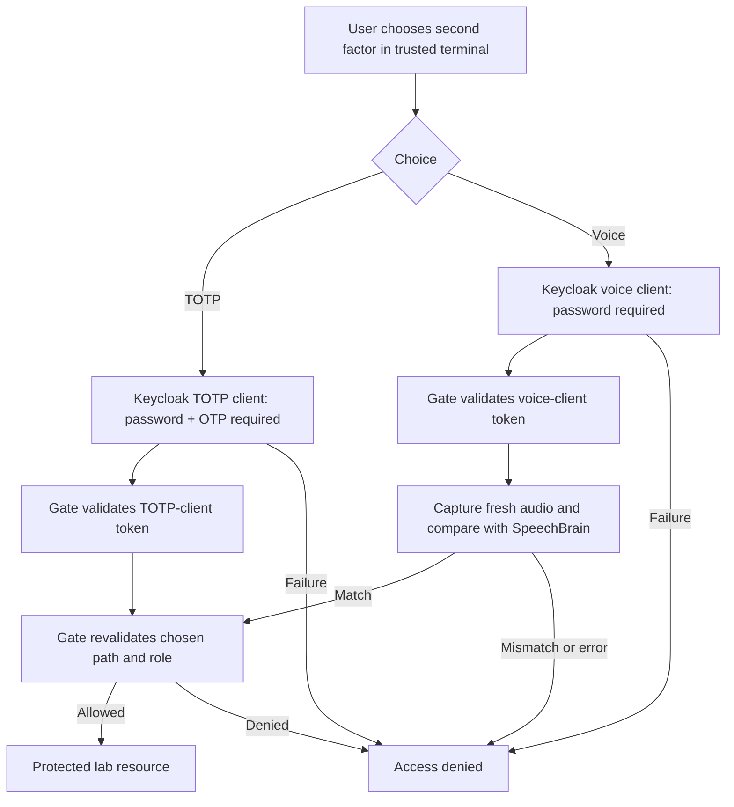

Yousef Taha
yr5hg
Idle

Anas — 6:28 PM
Apply the Kali flexible 2FA redesign
This update was prepared against main commit 923d3fe5203586a7e322bf42b82b277cd4b8f8d1 of yr5hg/Voice-Verification-Security-System (25 November 2026). GitHub read succeeded, but the write integration returned HTTP 403 when creating a branch. Nothing was changed remotely. The old feature branches feature/protected-backend and feature/speaker-verification were not modified. Review before merging.

Apply in Windows PowerShell (Git installed)

MIGRATION (1).md
4 KB
Expected vs observed test matrix (not yet executed)
ID	Case	Expected	Observed
T-01	TOTP path: correct password, fresh TOTP, allowed role, no voice	Allow	Pending
T-02	Incorrect password	No accepted Keycloak login	Pending

test_cases.md
5 KB
Kali Linux setup and first milestone
Proposed steps; not tested on your team's hardware. Confirm instructor permission for external tools, the voice-only Python exception, shell scripts and model download before installing. The standard Kali security tool catalogue does not supply the entire proposed MFA system.

1. Lab setup (all members)

KALI_SETUP.md
3 KB
Proposed architecture — Kali lab, password + choice of TOTP or voice
Status: design, not tested. Python restricted to SpeechBrain library and local voice comparison adapter. Keycloak and SpeechBrain are external tools; confirm instructor approval.

sequenceDiagram

architecture.md
3 KB
# Detailed Team Responsibilities — Kali Flexible Two-Factor Authentication

**Draft v0.4 | 25 November 2026 | Phase 2 deadline: 30 November 2026**

## 1. Team distribution

TEAM_RESPONSIBILITIES (2).md
20 KB
Shared Integration Contract — Kali Flexible Two-Factor Authentication (Draft v0.4)
25 November 2026. The old FastAPI and HTTP voice-service contract is retired. This filename is retained to preserve existing links. These are proposed interfaces, not tested functionality. All computer-side project components run on Kali; Python is permitted exclusively for SpeechBrain voice inference and its minimal local comparison adapter.

1. Trust boundary

api.md
10 KB
# Project Requirements — Password with TOTP or Voice Verification on Kali Linux

**Version:** Draft v0.4 (revised 25 November 2026)  
**Phase:** Information Systems Security — Phase 2, due **30 November 2026** (original repository deadline)  
**Status:** Proposed requirements, not evidence of implementation.  
**Companions:** `TEAM_RESPONSIBILITIES.md`, `contracts/api.md`, `docs/KALI_SETUP.md`.

PROJECT_REQUIREMENTS (1).md
21 KB
# Voice Verification Security System — Flexible Two-Factor Authentication on Kali Linux

Information Systems Security, Phase 2 — revised plan v0.4, 25 November 2026. Original deadline: 30 November 2026.

Every login requires a password and **one second factor chosen by the user: TOTP (Google Authenticator) OR experimental voice speaker verification**. Both methods are supported, but only two factors are required per login. This is flexible 2FA, not mandatory 3FA. Keycloak handles passwords and TOTP; SpeechBrain handles voice. A trusted local gate enforces the chosen path and RBAC before releasing a protected lab resource.

README.md
5 KB

# Voice Verification Security System — Flexible Two-Factor Authentication on Kali Linux

Information Systems Security, Phase 2 — revised plan v0.4, 25 November 2026. Original deadline: 30 November 2026.

Every login requires a password and **one second factor chosen by the user: TOTP (Google Authenticator) OR experimental voice speaker verification**. Both methods are supported, but only two factors are required per login. This is flexible 2FA, not mandatory 3FA. Keycloak handles passwords and TOTP; SpeechBrain handles voice. A trusted local gate enforces the chosen path and RBAC before releasing a protected lab resource.

**Technology restriction:** Kali Linux for all computer-side components. Python exclusively for SpeechBrain and its minimal local comparison adapter; all other work uses approved tools, configuration and Bash. No FastAPI, custom web backend, Python recording or tests. Keycloak and SpeechBrain are external software; confirm instructor approval. This package is a design and implementation plan, not a working/tested application.

The terminal selection occurs before Keycloak redirects, so the correct authentication flow can be chosen. No switching in mid-attempt: cancel and restart with a fresh password. The gate alone can dispatch protected operations. A password-only voice-client token never grants protected access. A TOTP-client token is accepted only for the dedicated required password+OTP flow, not merely because a token is active.

| Owner | Component | Directory |
|---|---|---|
| Omar Aljaouni | Keycloak, two client flows, password, TOTP, roles | `keycloak/` |
| Sara Alqadi | Microphone, audio processing, enrollment and terminal prompts | `voice-recording/` |
| Yousef Taha | SpeechBrain ECAPA-TDNN comparison and threshold | `voice-service/` |
| Anas Musa | Method selection, two-path integration, protected gate, RBAC/recovery | `access-control/` |
| Hamzeh Abu Jumaa | Authorized security testing and comparison of paths | `tests/` |

Read [requirements](PROJECT_REQUIREMENTS.md), [team tasks](TEAM_RESPONSIBILITIES.md), [integration contract](contracts/api.md), [Kali setup](docs/KALI_SETUP.md) and [architecture](docs/architecture.md). Component READMEs give implementation checkpoints. See [Phase 2 deliverables](docs/phase2/README.md).

## First checkpoint

- Omar proves the two dedicated confidential device-flow clients enforce the correct password/OTP requirements, including no SSO shortcut or cross-client token acceptance. Client-specific browser flow override behavior must be tested on the selected Keycloak release; do not assume it works for device flow.
- Sara captures valid 16-kHz WAV; Yousef reuses/adapts the previous SpeechBrain comparison on Kali, with calibrated threshold.
- Anas proves a real OS-protected resource boundary and separate attempt contexts; both paths must work, neither password-only nor cross-path token substitution may succeed.
- Hamzeh records real outcomes for both paths and negative tests. If a prerequisite fails, report component-level results rather than claiming complete 2FA.

Voice is experimental, not liveness or NIST-compliant biometric authentication; recorded or synthetic voices may match. An attacker can target the weaker enabled path. Keep voice enrollment and factor recovery supervised. No credentials, OTP seeds, recordings or embeddings in Git; the repository was public at the last review.
README.md
5 KB
