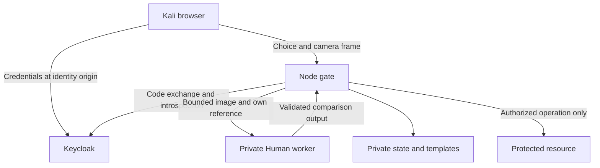
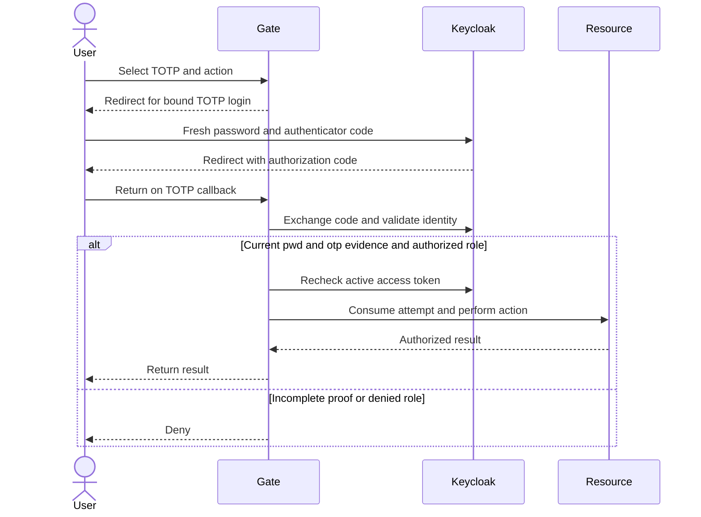
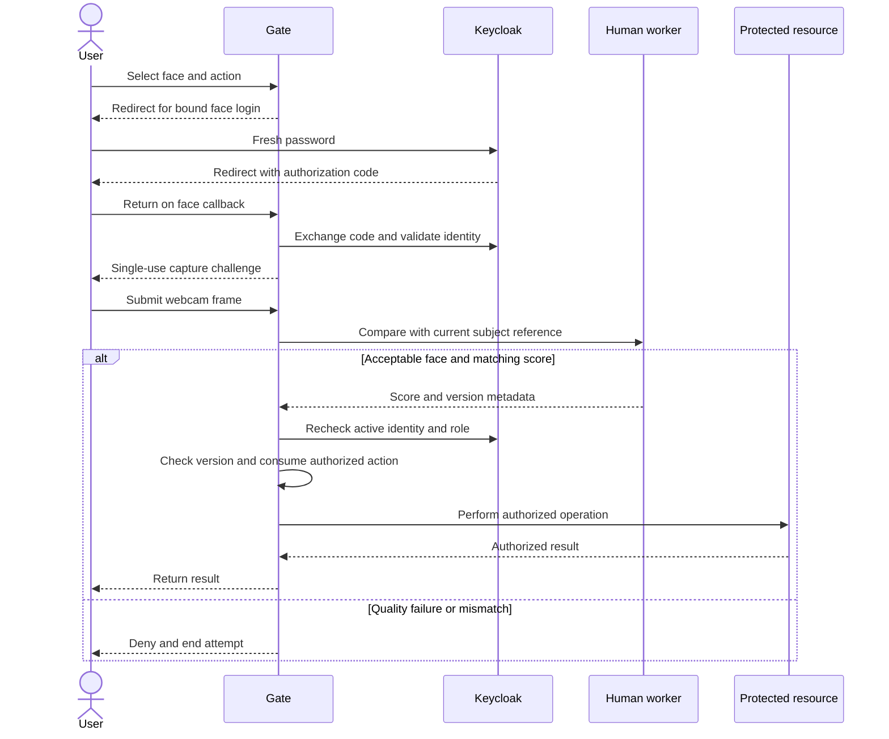
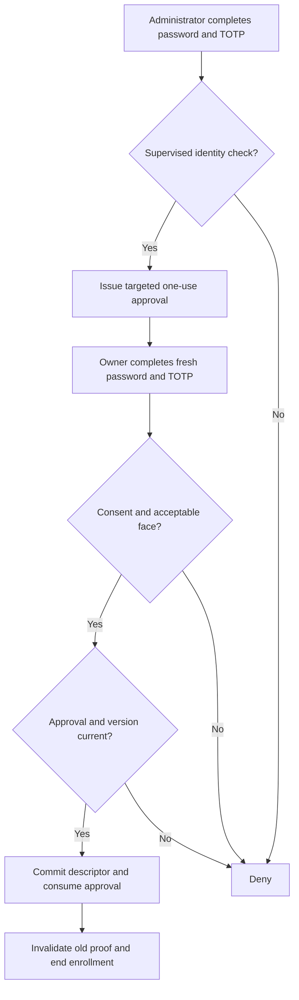
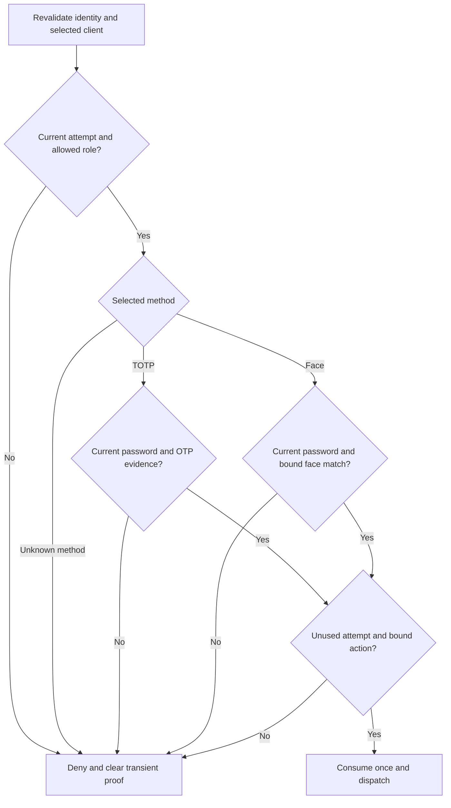

# System architecture

**Design for the Kali lab.** The browser captures pixels. Keycloak validates account credentials. One local Node application owns session state, a private Human worker and access to the protected resource. One operation consumes one authentication attempt. The [integration contract](contracts/api.md) defines the exact handoffs.

## Components and data boundaries

Everything depicted runs inside the guest. The separate authenticator device only generates TOTP codes. Human runs as an internal worker with a time budget; a worker failure must leave TOTP usable.

Store private state outside both the repository and the static UI directory under a dedicated OS account. Ordinary demo users cannot change service code, configuration, reference files or the protected operation.

## Password plus TOTP

The gate verifies signed evidence of the executed password and OTP steps and prior eligible TOTP enrollment.

Each successful diagram branch assumes the final recheck also succeeds. The camera and worker are outside this route.

## Password plus face

A gate challenge binds a submission to an attempt. It cannot certify when or how the submitted pixels were captured.

Similar-looking people, poor light, camera resolution, photos and video can affect outcomes. Blink cues or a successful browser demo do not establish liveness.

A person who can supply a convincing presentation may pass the face route even when server-side matching works as designed.

## Face enrollment and replacement

First-admin bootstrap is supervised offline. The operator handling factor administration is distinct from the target when approval would otherwise be self-issued.

Concurrent replacement and dispatch use the same subject/version lock. Recovery preserves roles and invalidates active sessions before access resumes.

## Protected access and failure handling

Mismatch, unknown authentication method, identity-provider outage, missing role, expired token, stale callback, malformed input or verifier timeout produces a bounded failure for the affected path.

Cancellation, a method switch or logout clears transient proof. A switch begins a fresh login.

Login failures and dispatch outcomes are audited with safe identifiers. The [test matrix](test_cases.md) includes independent TOTP operation during a face-worker outage, stale-version handling and direct resource denial.
