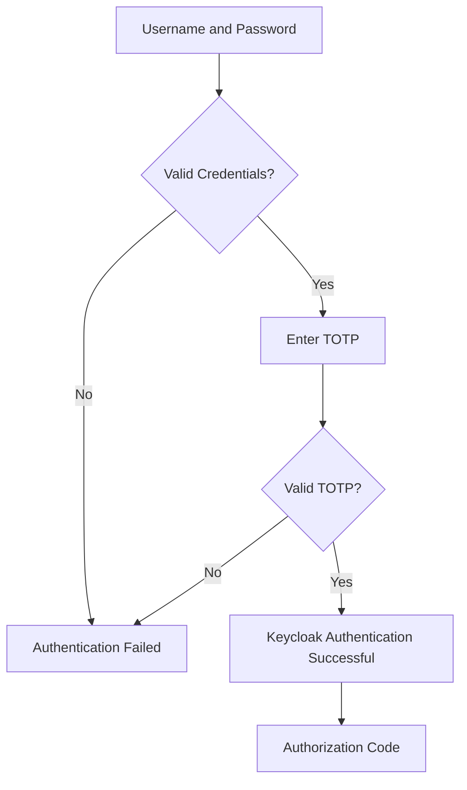
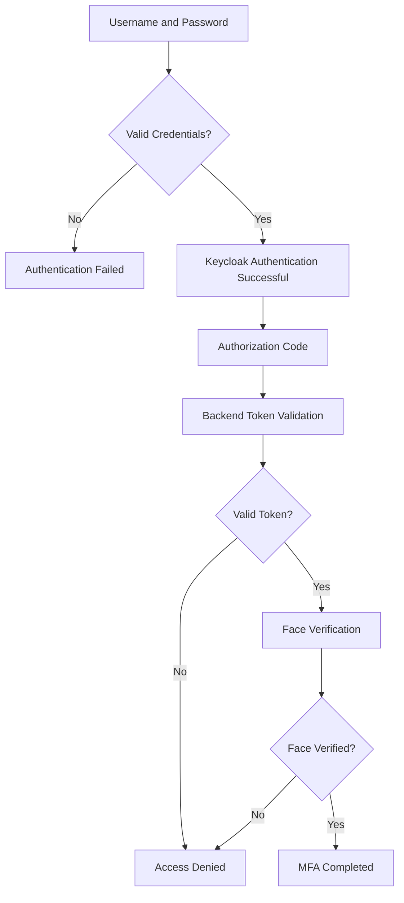

# Authentication Flows

## 1. Overview

The MFA Security System uses two dedicated Keycloak authentication flows:

- **Password + TOTP:** Both factors are verified by Keycloak.
- **Password + Face Verification:** Keycloak verifies the password, while face verification is completed externally before protected access is granted.

## 2. Client and Flow Configuration

| Configuration | TOTP | Face |
|---|---|---|
| Client ID | `gate-totp` | `gate-face` |
| Browser Flow | `mfa-totp-browser` | `mfa-face-browser` |
| Protocol | OpenID Connect | OpenID Connect |
| Standard Flow | Enabled | Enabled |
| PKCE | S256 | S256 |

Each client is assigned its corresponding browser flow through **Authentication Flow Overrides**.

## 3. Password + TOTP Flow

**Flow:** `mfa-totp-browser`

| Execution | Requirement |
|---|---|
| Username Password Form | Required |
| OTP Form | Required |



Both factors must be successfully verified before Keycloak completes authentication.

## 4. Password + Face Verification Flow

**Flow:** `mfa-face-browser`

| Execution | Requirement |
|---|---|
| Username Password Form | Required |
| OTP Form | Not Included |
| Face Verification | External to Keycloak |



Successful Keycloak authentication completes only the first factor. Protected access remains blocked until face verification succeeds and the required permissions are validated.

## 5. Authentication Method Reference (AMR)

### Authenticator References

| Authentication Method | Reference |
|---|---|
| Password | `pwd` |
| TOTP | `otp` |

### Protocol Mapper Configuration

| Setting | TOTP Client | Face Client |
|---|---|---|
| Dedicated Scope | `gate-totp-dedicated` | `gate-face-dedicated` |
| Mapper Name | `totp-amr-mapper` | `face-amr-mapper` |
| Mapper Type | Authentication Method Reference | Authentication Method Reference |
| Add to ID Token | ON | ON |
| Add to Access Token | ON | ON |
| Add to Lightweight Access Token | OFF | OFF |

### Expected AMR Claims

**TOTP route:**

```json
{
  "amr": ["pwd", "otp"]
}
```

**Face route — Keycloak authentication stage:**

```json
{
  "amr": ["pwd"]
}
```

Face verification is not represented as a completed authentication factor by Keycloak. It must be verified separately.

## 6. Integration Parameters

| Parameter | Expected Value |
|---|---|
| TOTP Callback URL | `https://gate.test:8444/oidc/totp/callback` |
| Face Callback URL | `https://gate.test:8444/oidc/face/callback` |
| Resource Audience | `lab-resource` |

Final callback verification and audience mapping are part of backend integration.

## 7. Authentication Requirements

- Both clients use their designated authentication flows.
- Required authentication factors must not be bypassed through existing SSO sessions.
- Issued tokens must be validated before granting protected access.
- Password authentication alone is insufficient to complete the face authentication route.
- Successful MFA does not replace role-based authorization.

> The documented configuration reflects the prepared Keycloak setup. Expected AMR claims, MFA enforcement, and integration behavior remain subject to verification.

Additional security policies are documented in [SECURITY_CONFIGURATION.md](SECURITY_CONFIGURATION.md).
