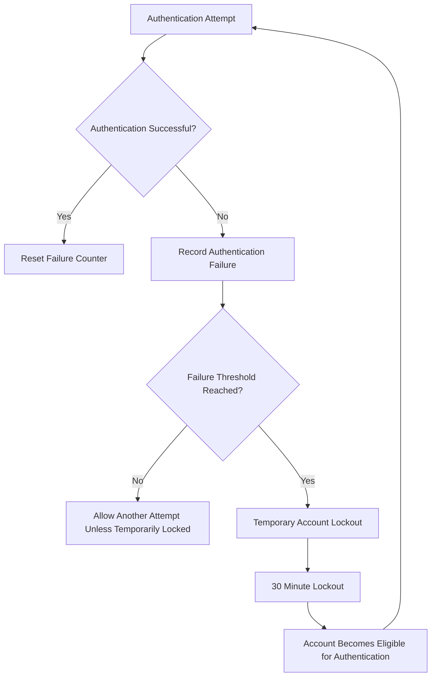
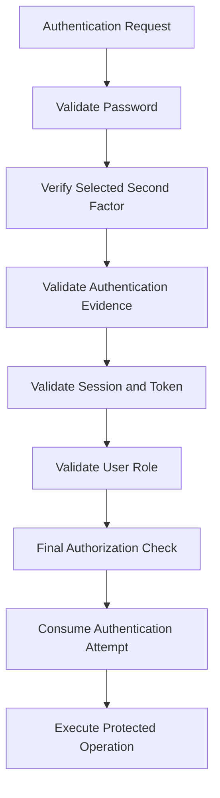

# Security Configuration

## 1. Overview

The MFA Security System uses centralized Keycloak security policies to protect user credentials, authentication sessions, and token-based access.

The security configuration covers password requirements, TOTP verification, brute-force protection, session restrictions, token management, role-based access control, and security event logging.

All policies apply to the `multi-factor-authentication` realm unless explicitly overridden at the client level.

## 2. Password Policy

Password requirements reduce the likelihood of users selecting easily guessable credentials.

| Policy | Configuration Baseline |
|---|---|
| Minimum Password Length | 12 characters |
| Uppercase Characters | At least 1 |
| Lowercase Characters | At least 1 |
| Numerical Digits | At least 1 |
| Special Characters | At least 1 |
| Not Username | Enabled |

Passwords must satisfy the configured policy when created or updated.

The policy does not require unnecessary changes to existing credentials. Existing passwords must be updated separately if compliance with a newly applied policy is required.

## 3. TOTP Policy

Time-based one-time passwords provide an additional authentication factor based on possession of an enrolled authenticator.

| Setting | Value |
|---|---|
| OTP Type | TOTP |
| Number of Digits | 6 |
| Token Period | 30 seconds |
| Reusable Code | Disabled |

The authenticator generates a new code every 30 seconds. Successfully consumed codes cannot be reused.

TOTP enrollment secrets must remain private. Existing enrollment parameters are preserved to maintain compatibility with registered authenticator applications.

## 4. Brute-Force Protection

Brute-force protection limits repeated authentication failures and reduces the effectiveness of automated credential guessing.

### 4.1 Configuration

| Setting | Value |
|---|---|
| Brute Force Mode | Lockout temporarily |
| Maximum Login Failures | 6 |
| Maximum Secondary Authentication Failures | 0 |
| Wait Time Strategy | Multiple |
| Wait Increment | 30 minutes |
| Maximum Wait | 30 minutes |
| Failure Reset Time | 30 minutes |
| Quick Login Check | 1000 milliseconds |
| Minimum Quick Login Wait | 1 minute |

### 4.2 Account Lockout Behavior

The configured policy targets the following behavior:

- Six failed authentication attempts trigger a temporary account lockout.
- The normal lockout duration is 30 minutes.
- Failure counters become eligible for reset after the configured inactivity period.
- Rapid authentication attempts may trigger an earlier one-minute lockout.
- Successful authentication resets the applicable failure counter.
- Permanent account lockout is not part of the selected policy.

The maximum secondary authentication failures setting is zero to avoid enabling an additional permanent lockout threshold.

The built-in protection applies to supported password and OTP authenticators. External face verification uses separate backend-controlled failure restrictions.

The exact reset and lockout behavior must be evaluated against the deployed Keycloak version.

## 5. Face Verification Protection

Face verification is performed outside Keycloak using the local Human-based verification component.

The application gate controls authentication attempts and applies independent restrictions to repeated biometric verification failures.

| Setting | Value |
|---|---|
| Failed Verification Limit | 3 |
| Failure Window | 300 seconds |
| Cooldown Period | 300 seconds |
| Capture Challenge Lifetime | 60 seconds |
| Inference Timeout | 10,000 milliseconds |
| Maximum Capture Size | 1,048,576 bytes |

Face comparison results must originate from the trusted local verification component.

A browser-generated success message is not sufficient authentication evidence.

The similarity threshold must be calibrated using experimental evaluation. Facial comparison alone does not establish reliable liveness or resistance to presentation attacks.

## 6. Session Security

Session restrictions limit how long authenticated sessions remain usable.

### 6.1 Standard Sessions

| Setting | Value |
|---|---|
| SSO Session Idle | 15 minutes |
| SSO Session Max | 1 hour |
| Client Session Idle | 10 minutes |
| Client Session Max | 30 minutes |

- **Idle:** Maximum permitted inactivity before session expiration.
- **Max:** Absolute session lifetime, regardless of activity.

Client-level restrictions provide shorter application sessions within the overall realm session lifetime.

### 6.2 Offline Sessions

| Setting | Value |
|---|---|
| Offline Session Idle | 30 days |
| Client Offline Session Idle | 0 minutes |
| Offline Session Max Limited | Enabled |
| Offline Session Max | 30 days |
| Client Offline Session Max | 0 minutes |

Offline sessions allow authorized applications to obtain new access tokens independently of an ordinary browser session.

A zero client-specific value inherits the applicable realm-level setting.

Offline access must not be requested unless required by the application.

### 6.3 Login Time Limits

| Setting | Value |
|---|---|
| Login Timeout | 5 minutes |
| Login Action Timeout | 2 minutes |

These restrictions prevent incomplete authentication processes from remaining valid indefinitely.

## 7. Token Security

### 7.1 Token Configuration Baseline

| Setting | Value |
|---|---|
| Signature Algorithm | RS256 |
| Access Token Lifespan | 5 minutes |
| Revoke Refresh Token | Enabled |
| Refresh Token Max Reuse | 0 |
| Client Login Timeout | 1 minute |

Digitally signed tokens provide verifiable authentication and authorization information.

Short-lived access tokens reduce the exposure period of compromised tokens. Refresh token rotation reduces the opportunity to reuse previously exchanged refresh tokens.

### 7.2 Token Validation

The application validates the applicable token properties before allowing protected operations.

| Validation | Purpose |
|---|---|
| Signature | Verify token authenticity and integrity |
| Issuer | Verify the trusted Keycloak realm |
| Audience | Verify the intended resource |
| Expiration | Reject expired tokens |
| Client Identity | Verify the selected authentication client |
| Authentication Evidence | Verify the required authentication methods |
| Roles | Determine permitted operations |
| Active Token Status | Reject invalidated or inactive authentication |

Refresh token handling must preserve the latest valid token when rotation is enabled.

Token renewal does not create a new completed MFA attempt or authorize a new protected operation independently.

## 8. Role-Based Access Control

Authentication establishes user identity. Authorization determines the operations that the authenticated identity may perform.

| Application Role | Authorized Access |
|---|---|
| Standard User | Ordinary protected user operations |
| Administrator | Ordinary operations and administrator-restricted operations |

Application roles are assigned through Keycloak role mappings.

The application gate validates trusted role information before executing protected operations.

Application administrators must not receive Keycloak administration privileges unless explicitly authorized to manage the identity provider.

All protected operations require valid authentication, completed second-factor verification, and the appropriate role.

## 9. Security Event Logging

Security events provide an audit trail for authentication activity and administrative changes.

### 9.1 User Events

| Setting | Value |
|---|---|
| Save Events | Enabled |
| Event Retention | 30 days |
| Event Listener | `jboss-logging` |

Relevant authentication events include:

| Event | Recorded Activity |
|---|---|
| LOGIN | Successful authentication |
| LOGIN_ERROR | Failed authentication |
| LOGOUT | Successful logout |
| LOGOUT_ERROR | Failed logout |
| CODE_TO_TOKEN | Authorization code exchange |
| CODE_TO_TOKEN_ERROR | Failed authorization code exchange |
| CLIENT_LOGIN | Successful client authentication |
| CLIENT_LOGIN_ERROR | Failed client authentication |
| REFRESH_TOKEN | Token renewal |
| REFRESH_TOKEN_ERROR | Failed token renewal |
| UPDATE_CREDENTIAL | Credential update |
| UPDATE_CREDENTIAL_ERROR | Failed credential update |
| RESET_PASSWORD | Password reset |
| RESET_PASSWORD_ERROR | Failed password reset |

The configured event selection supports authentication monitoring and investigation of security failures.

### 9.2 Administrator Events

| Setting | Value |
|---|---|
| Save Events | Enabled |
| Include Representation | Disabled |
| Retention Target | 30 days |

Administrator events record management operations affecting users, roles, clients, authentication flows, and realm configuration.

Detailed representations are excluded to reduce unnecessary exposure of configuration data.

### 9.3 Application Events

The application maintains separate security records for external face verification, authorization decisions, rejected protected operations, and authentication attempt consumption.

Sensitive credentials, raw facial images, biometric templates, and authentication tokens must not be included in application logs.

## 10. Security Enforcement

The authentication and authorization controls operate together before a protected action is executed.

Failure at any required security check results in access denial.

Each protected operation requires valid, current authentication evidence. Previously completed authentication attempts must not be reused to authorize additional operations.

## 11. Configuration References

- [Authentication Flows](AUTHENTICATION_FLOWS.md)
- [Deployment Configuration](DEPLOYMENT.md)
- [System Architecture](../architecture.md)
- [Security Test Cases](../test_cases.md)
- [Keycloak Administration Guide](https://www.keycloak.org/docs/latest/server_admin/)

This document defines the security configuration baseline. Actual deployment values and security behavior are verified against the realm export, application configuration, and independent test results.
